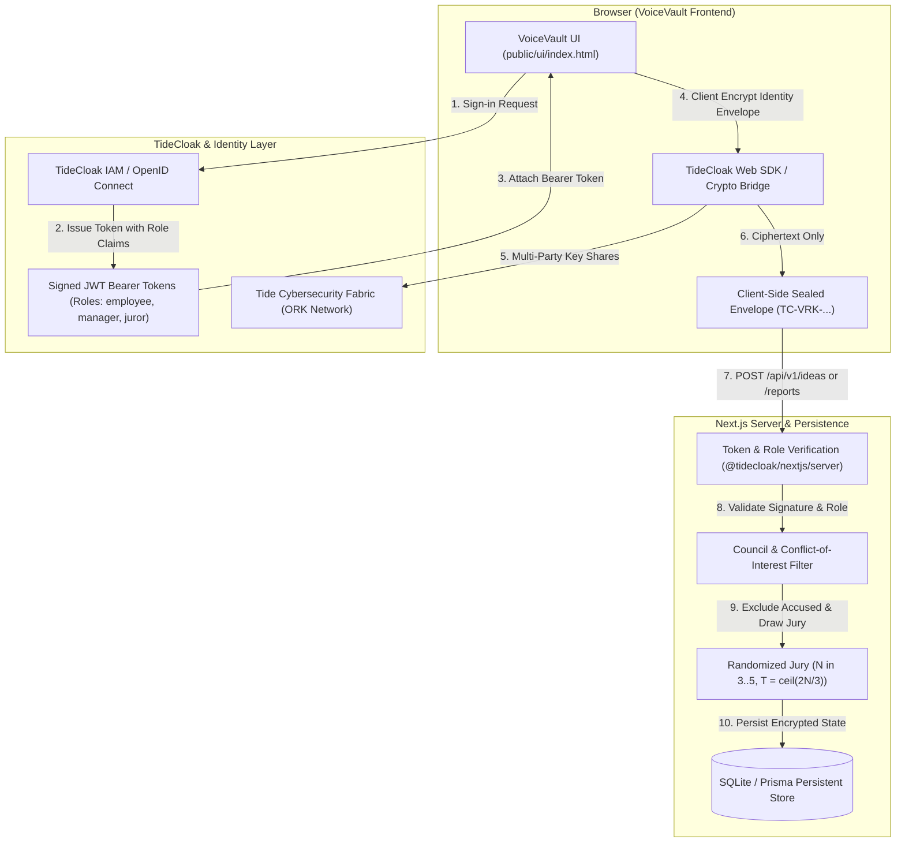

# TideCloak Architecture & Integration Plan (Tide MCP)
> **VoiceVault — RMIT × Tide UNLOCKED Hackathon 2026**  
> *Track: Emergent Authority & Decentralized Identity*

---

## 1. Executive Summary & Objective

This document outlines the end-to-end integration architecture of **TideCloak** within the VoiceVault application, formulated using Tide's Model Context Protocol (MCP) and official documentation guidelines.

Due to temporary upstream availability constraints in the live TideCloak devnet/fabric, this prototype implements a **hybrid architecture**:
- **Simulated TideCloak Engine (`SIMULATED`)**: High-fidelity simulation of TideCloak's sign-in flow, JWT bearer token issuance, role declarations, and cryptographic access checks.
- **Tide Cybersecurity Fabric Target Architecture (`FABRIC`)**: Fully specified integration points for browser-side envelope encryption, Open Resource Keeper (ORK) key splitting, and decentralized Emergent Authority quorum gating.

---

## 2. Where TideCloak Fits in the Architecture

---

## 3. Core Architectural Integration Points

### Point 1: Decentralized Sign-in and Role Claims
- **Where it fits**: At the edge authentication layer.
- **How it works**:
  - Users authenticate via TideCloak credentials (`username`, `password`) or decentralized wallets.
  - TideCloak issues signed tokens embedding roles:
    - `employee`: Base access for submitting sealed ideas and whistleblowing reports.
    - `manager`: Permission to endorse submitted ideas (`POST /api/v1/ideas/:id/endorse`).
    - `director`: Permission to formally approve/reject ideas (`POST /api/v1/ideas/:id/decision`).
    - `juror`: Permission to cast votes on unmasking requests for designated reports.
  - Server verifies tokens using `@tidecloak/nextjs/server` and `@tidecloak/verify`, rejecting invalid, expired, or tampered tokens with `403 Forbidden`.

### Point 2: Client-Side Envelope Encryption (Zero-Knowledge Identity)
- **Where it fits**: In the browser before HTTP dispatch (`submitIdea`, `submitReport`).
- **How it works**:
  - The author's identity and metadata are encrypted client-side using `encryptJson(payload, tag)`.
  - The server only ever receives and stores the opaque ciphertext envelope (`authorCiphertext` or `reporterCiphertext`).
  - Even a rogue DBA or compromised server administrator cannot view the speaker's plaintext identity.

### Point 3: Emergent Authority Multi-Party Quorum Gating
- **Where it fits**: In `/api/v1/voting-requests/[id]/approvals` and `/api/v1/voting-requests/[id]/reveal`.
- **How it works**:
  - Identity unmasking does **not** rely on an administrative master key.
  - A report accusing an executive automatically purges that executive from the review pool.
  - A randomized jury of size $N \in [3, 5]$ is drawn with at least one verified independent external member.
  - Release requires a quorum of $T = \lceil 2N/3 \rceil$ cryptographically verified approvals, including the independent member.
  - A single valid veto (`DENY`) immediately and permanently terminates disclosure.

### Point 4: Honest Provenance & Audit Logging
- **Where it fits**: `/api/v1/audit` and UI audit stream.
- **How it works**:
  - Every action recorded by the system includes an immutable `source` tag:
    - `[FABRIC]`: Cryptographically verified by live TideCloak fabric or container.
    - `[APP]`: Enforced by server application logic (e.g. jury draw, CoI exclusion).
    - `[SIMULATED]`: Emulated authorization or mock step clearly disclosed to the user.

---

## 4. Simulation vs. Live Implementation Matrix

| Security Property | Simulated Mode (`SIMULATED`) | Live Mode (`FABRIC`) |
| :--- | :--- | :--- |
| **Authentication Flow** | `POST /api/v1/auth/token` returns HMAC-SHA256 JWT with Keycloak claims | TideCloak Dev Server (`/realms/myrealm/protocol/openid-connect/token`) |
| **Token Verification** | `verifySimulatedToken()` checks signature, timestamp, and realm roles | `@tidecloak/nextjs/server` validates via remote JWKS endpoint |
| **Role Enforcement** | Server guards `/api/protected` and `/api/v1/ideas/:id/endorse` | Same server-side guards against real token claims |
| **Identity Envelopes** | Client-sealed envelope mock (`TC-VRK-...`) stored in SQLite | Tide Web SDK `encryptJson` backed by decentralized ORKs |
| **Quorum Calculation** | Algorithmic $T = \lceil 2N/3 \rceil$ with independent juror check | Multi-party threshold signature combination |

---

## 5. How to Toggle Modes

VoiceVault is designed with dual-mode zero-friction switching:
- **Simulation Mode (Default when TideCloak is offline)**:
  - App operates out-of-the-box without Docker.
  - Tokens issued via `POST /api/v1/auth/token`.
- **Live TideCloak Mode**:
  - Start container: `docker run -d --name tidecloak -p 8081:8080 tideorg/tidecloak-dev`
  - Real tokens acquired from `http://localhost:8081` are automatically recognized and verified.
